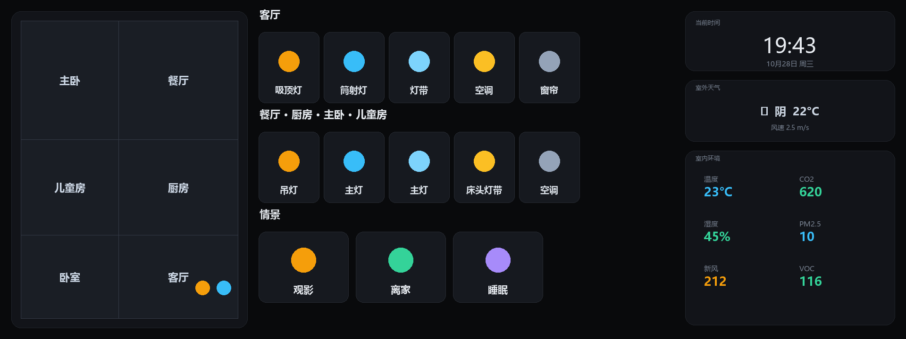

# COLMO 智慧屏 → Home Assistant 全屋中控 改造教程

把一块「只能开关自家空调」的 COLMO 智慧屏，改造成一台挂在墙上的 **Home Assistant 全屋智能中控屏**。

## 项目综述

本项目并不改动 COLMO 屏的硬件，而是把它当作一台 **Android 平板**，用软件手段替换掉出厂锁定的桌面系统：

1. **开启调试**：通过 COLMO 屏隐藏的开发者入口，打开 USB / 网络 ADB 调试，获得对系统的控制权；
2. **安装中控 App**：在屏上安装 Home Assistant Companion（Android 客户端），让它以 Kiosk 全屏模式常驻；
3. **页面布局**：针对这块 1920×720 的条屏，用 picture-elements 定制一套按房间分组的 Lovelace 控制面板；
4. **固定屏幕显示**：屏保关闭、屏幕常亮，把 HA 设为默认桌面，冷启动/重启后自动直达中控，不留出厂界面；
5. **调用自带的硬件**：把屏上的毫米波雷达、板载温湿度 / VOC 传感器利用起来，实现「有人亮屏、无人息屏」的人感调光，并把环境数据实时上报回 HA。

整套改造是纯软件方案，可逆、不拆机、不刷机（无需 root 也可完成核心功能），改完就是一块真正全屋统一控制的中控屏。

本项目是作者在真实设备上完整跑通后的总结，包含：

- ✅ 完整的**开启调试**过程（COLMO 屏隐藏的开发者入口）
- ✅ 屏幕端**常驻脚本**（雷达人感自动亮屏/息屏、板载传感器上报、watchdog 守护）
- ✅ HA 侧**面板构建方法**（1920×720 条屏布局）
- ✅ 过程中踩过的**所有坑**（内存、光感、进程匹配、背光……）

> 全部内容已脱敏，不含任何账号、密码、令牌、设备 GUID 等私有信息。
> 文中出现的 IP、实体 ID、户型图均为示例，请替换为你自己的。

---

## 目录

1. [这是什么 / 适用人群](#这是什么)
2. [最终效果](#最终效果)
3. [前置条件](#前置条件)
4. [第一步：开启调试（含 COLMO 隐藏入口）](#第一步开启调试)
5. [第二步：安装 Home Assistant Companion](#第二步安装-home-assistant-companion)
6. [第三步：部署屏幕端常驻脚本](#第三步部署屏幕端常驻脚本)
7. [第四步：构建你的中控面板](#第四步构建你的中控面板)
8. [避坑清单（务必先读）](#避坑清单)
9. [风险与免责声明](#风险与免责声明)
10. [关于「借助 WorkBuddy 复刻」](#关于借助-workbuddy-复刻)

---

## 这是什么

COLMO 智慧屏本质上是一块 **Android 平板**（RK3566 方案、Android 11、常见 1920×720 条屏、2GB 内存、无电池纯市电），出厂固件被锁在美的/COLMO 生态内，只能控制自家设备。

如果你的家是「混血生态」（美的 + 米家 + 其他），它的上限就卡在品牌墙里。出路只有一条：**把它当 Android 平板，装第三方中控 Home Assistant**。

本教程就是这条路的完整走法。

## 最终效果



> 上图为通用化示例（房间名、设备、数据均为示例），实际效果取决于你的户型图与设备。

- 屏幕常亮显示 HA 的 Lovelace 面板，按房间分组控制全屋设备
- **雷达人感**：有人靠近自动亮屏，无人 60 秒微暗、180 秒纯黑（省电不烧屏）
- **板载传感器**：温度 / 湿度 / VOC 空气质量自动上报进 HA
- 熄屏/唤醒全程无卡顿（不真正熄屏，靠背光归零做伪黑屏）

## 前置条件

| 项 | 要求 |
|----|------|
| COLMO 智慧屏 | 一台，建议已联网（连到与 HA 同一局域网） |
| 一台电脑 | Windows/macOS/Linux 均可，需能装 adb |
| Home Assistant | 已搭好并运行，记下其局域网 IP（如 `192.168.1.100:8123`） |
| HA 长期令牌 | 用于脚本鉴权，[官方说明](https://www.home-assistant.io/docs/authentication/#your-account-profile) |
| 一根 USB 数据线 | 可选，用于首次 adb 授权（部分屏可直接无线） |

---

## 第一步：开启调试

COLMO 屏把安卓的原生「设置」隐藏了，需要从系统界面里连点一个隐藏入口把它叫出来。

### 1.1 打开隐藏的安卓设置

1. 在屏上进入 COLMO 的系统设置页，找到 **「关于本机 / 设备信息」** 之类页面，里面有「序列号 SN」。
2. **连点「序列号」右边的那串数字**（注意是点数字本身，不是点"序列号"三个字）。连续快速点 **12 下左右**，会跳进安卓原生设置界面。

> ⚠️ **不同批次的屏入口可能不一样**，有的要点序列号、有的要点型号、有的要点固件版本号。如果点了没反应，就换「型号」「版本号」「SN」逐个试，通常 8～12 下内会触发。

### 1.2 开启开发者选项

1. 进入安卓设置后，找到 **「关于平板电脑」**（或「关于本机」）。
2. 拉到最底部，找到 **「Build 号 / 版本号」**，**连点 7 下**，会提示「您已处于开发者模式」。
3. 返回上一级，就能看到 **「开发者选项」** 菜单。

### 1.3 开启调试

1. 进入「开发者选项」。
2. 打开 **「USB 调试」**。
3. （可选）打开 **「无线调试」**——如果你不想用 USB 线，走无线调试更省事。COLMO 屏通常**默认开放 5555 网络调试端口**，无需额外设置。

### 1.4 连接 adb

电脑上装好 adb（Android SDK Platform-Tools），然后：

**方式 A：网络直连（推荐，COLMO 屏默认开 5555）**

```bash
adb connect <屏的IP>:5555
# 屏上会弹「允许 USB 调试吗」，勾选「始终允许」并点允许
adb devices
# 应显示：<屏的IP>:5555  device
```

**方式 B：无线调试配对（Android 11 的配对码机制）**

如果 `adb connect` 连不上，说明屏用的是「无线调试」配对模式。在屏的「开发者选项 > 无线调试」里点「使用配对码配对设备」，记下 `IP:端口` 和 `6 位配对码`，然后用：

```bash
# 项目里附带的脚本会自动完成配对 + 连接 + 持久化
./scripts/adb_pair.sh <IP:端口> <6位配对码>
```

**方式 C：USB 线**

USB 线连电脑，`adb devices` 确认识别，然后在屏上允许调试。之后可 `adb tcpip 5555` 转成无线，拔掉线。

> 项目里提供了 `scripts/adb_pair.sh`，帮你把 5555 端口持久化（`persist.adb.tcp.port=5555`），重启后也能直连。

---

## 第二步：安装 Home Assistant Companion

COLMO 屏 **没有 Google 服务（GMS）**，所以不能装普通版 Companion（它依赖 GMS 的推送），必须装 **minimal 变体**：

- APK 包名：`io.homeassistant.companion.android.minimal`
- 从 HA Companion 官方 GitHub Releases 下载对应 APK，`adb install` 装进屏里。

```bash
adb install home-assistant-companion-minimal.apk
```

装好后在屏上打开，登录你的 HA 账号，让它注册为一个设备（之后脚本里的「意外熄屏拉回 HA」就靠它）。

> 如果屏上没有 HA 的登录入口，或想让它开机直接进面板，参考「第四步」里的 kiosk 模式 + 默认面板设置。

---

## 第三步：部署屏幕端常驻脚本

项目 `scripts/` 目录下有 5 个脚本，是屏上跑的核心逻辑：

| 脚本 | 作用 |
|------|------|
| `panel_auto.sh` | 一体化管家：雷达人感 + 三档调光（正常/微暗/纯黑） |
| `panel_guard.sh` | watchdog，每 10 秒巡检，拉起意外死亡的常驻 |
| `start_agents.sh` | 一键拉起上面两个 + 传感器上报 |
| `sbc_sensor.sh` | 板载 sgp40 传感器（温度/湿度/VOC）上报 HA |
| `adb_pair.sh` | 电脑端用的无线调试配对工具 |

### 部署步骤

1. **改配置**：编辑 `panel_auto.sh` 和 `sbc_sensor.sh` 顶部的 `HA_HOST` 为你的 HA IP。

2. **推 token**：把你的 HA 长期令牌写到屏上：

   ```bash
   adb shell "echo '你的HA长期令牌' > /data/local/tmp/.ha_token"
   ```

3. **推送脚本**：

   ```bash
   adb push scripts/panel_auto.sh /data/local/tmp/
   adb push scripts/panel_guard.sh /data/local/tmp/
   adb push scripts/start_agents.sh /data/local/tmp/
   adb push scripts/sbc_sensor.sh /data/local/tmp/
   ```

4. **启动**：

   ```bash
   adb shell sh /data/local/tmp/start_agents.sh
   ```

> 前提：脚本里默认的雷达串口 `/dev/ttyACM0`、背光节点 `/sys/class/backlight/backlight/brightness`、板载传感器 `/sys/bus/iio/devices/iio:device1` 都是作者这台 COLMO 屏的实测路径。**如果你的屏硬件不同，需要先用 `adb shell` 进去确认这些路径是否存在**，不存在就对应删掉相关逻辑（比如没有雷达就只留调光，没有 sgp40 就不跑 sbc_sensor）。

---

## 第四步：构建你的中控面板

这是最有「发挥空间」的一步。核心思路：

- HA 的 Lovelace 用 `picture-elements` 卡片，把中文按钮框和标签**画在底图 PNG 上**，交互热区用透明元素叠加。
- 画布按 **1920×720**（比例 2.6667）设计，配合 kiosk-mode 全屏。

### 4.1 面板生成器（参考实现）

`panel-builder/build_panel.py` 是一个**参考实现**（已脱敏、剥离作者私有实体），它演示了：

- 用 Python PIL 在底图上画按钮框、房间标签、数值标签
- 生成 `picture-elements` 的 elements JSON（`state-label`、`icon` + `conditional`）
- 上传底图到 HA 的 `/api/image/upload`，拿到 image id

**你要做的**：把里面的示例实体 ID、户型图路径、字体路径，替换成你自己的。

### 4.2 关键 API 与坑（务必看）

- **`icon_el` 的 x/y 是元素「中心」，不是左上角**。写定位时传卡片/按钮中心坐标。
- **`conditional` 不会把 entity 传给子元素**——子元素必须自己写 `entity`，否则 `toggle`/`more-info` 静默失败；缺 entity 的 more-info 会渲染成深灰矩形卡在左下角。
- **图标名别写错**：MDI 库里没有 `mdi:curtains-open`，窗帘打开态用 `mdi:curtains`、关闭态用 `mdi:curtains-closed`，写错会静默渲染为空。
- **弹窗放大**：条屏上 HA 的 `more-info` 弹窗偏小，需要用自定义 CSS 资源放大（改 `--ha-dialog-width-md` 等变量；其中 `ha-control-button` 的 `:host` 硬编码了 40px，CSS 变量无效，得用 JS 遍历 shadow root 写 inline style）。
- **主题改动必须重启 HA**（`reload_core_config` 不重载 themes）。
- **默认面板**：HA 2026.2 起默认面板是内置 `home`，要让屏冷启动直达中控，需把默认面板设为你的面板 `url_path`（不是 `lovelace-xxx`，是 `get_panels` 里的 `url_path`）。

### 4.3 kiosk 全屏

全屏隐藏 HA 顶栏/侧栏，用社区 [kiosk-mode](https://github.com/NemesisRE/kiosk-mode) 即可（HACS 安装），在面板配置里加 `kiosk_mode:` 根键，或 URL 加 `?kiosk`。

---

## 避坑清单

以下是作者在真实设备上踩过、且最容易让后来者翻车的问题：

### 内存（2GB 是硬约束）
- 屏只有 **2GB 内存**，LMK 会随时杀后台进程 → 常驻脚本必须写 `oom_score_adj=-1000` 保命，并用 watchdog 巡检。
- **屏幕永不真正熄屏**（`stayon` + `screen_off_timeout` 拉满），靠**背光归零**做伪黑屏。否则真熄屏会让 LMK 杀掉 WebView，唤醒要重建，出现启动页 + 卡顿。

### 进程匹配的致命坑
- **绝不能用 `ps | grep "[$N].sh"`** 来匹配脚本进程：`$N` 展开后 `[panel_auto]` 的方括号成了「字符类」，内核线程 `[kdmflush]` 里的 "lush" 会被误判命中 → **实测误杀整条进程树**。
- 也不要逐个 `cat /proc/<pid>/cmdline`（约 400 次 fork，慢到卡死）。
- 正确写法：单次 `ps -A -o PID,ARGS | awk` 按字段匹配（见脚本里的 `list_pid()`）。

### 光感（别浪费时间找）
- 这台屏**光感硬件不可用**：设备树里有 light 节点，但芯片空焊、无 ACK；`dumpsys sensorservice` 里全是虚拟传感器；偶尔出现的 lux 值是停更的虚拟值。
- 系统「自动亮度」开关会拿陈旧缓存回写背光，**会冲掉纯黑**。脚本每 ~25 秒强制把它复位为手动。
- 替代方案：用 HA 的 `sun.sun`（日出日落）做明暗代理，白天/夜间两档。

### 雷达人感（真源在这）
- 人感真源是 **USB 毫米波雷达 `/dev/ttyACM0`**（约 1 米），不是设备树里那些 proximity 节点。
- 判据：逐字节匹配独立 `0x01` 字节（`od -w1` 逐字节后 `grep -cx '01'`），**不能对拼接串 grep**（"d0"+"1x" 会跨界拼出 01 误判）。

### 提亮「肉眼即时」的细节
- 提亮**先写硬件背光**（~22ms 生效）再补 `settings put`（~79ms），顺序反了白等 0.1s。
- 热循环**别调外部 `date`**（每次 51ms），用 mksh 内置 `$SECONDS`。
- `dumpsys power` 是热循环里最贵的调用，节流为每 3 轮一次。

### 网络
- 屏上 **没有 curl/wget 可用**，只能用 `nc`（toybox netcat）。而且 `busybox wget` 不支持自定义 header，要发带 `Authorization` 的请求必须用 `printf ... | busybox nc`。

### 面板布局
- **删/加一个按钮 = 同行右侧所有按钮左/右移一个 chip 宽度**，换底图后必须同步热区坐标，否则「显示」和「控制」错位。
- 户型图用原图，别做 inpaint 擦字（容易破坏标注）。

---

## 风险与免责声明

1. **改造会影响保修**。经销商对这类改造态度暧昧、官方没有条款可依，动手前先问售后要一句准话，拿不到就当没有官方支持。
2. **不同批次的屏入口可能不同**，本教程的开启调试路径基于作者这台屏实测，你的屏可能要变通。
3. **改之前先备份**，进阶操作（如 root、改 persist 属性）量力而行。
4. 本项目仅用于个人自用、学习研究，**不涉及商业用途**，不攻击任何云服务，请勿批量刷接口。

---

## 关于「借助 WorkBuddy 复刻」

本教程描述的每一步，都可以在 **WorkBuddy** 里用自然语言让 AI 帮你完成——不必自己手敲 adb 命令或改脚本。

你可以直接对 WorkBuddy 说：

> 「我有一台 COLMO 智慧屏（Android 11，1920×720），想把它改成 Home Assistant 全屋中控屏。参考 ha-colmo-panel 这个项目的思路，帮我一步一步做：先教我开启调试，再装 HA Companion，然后部署屏幕端脚本，最后生成一个三列布局的面板。」

WorkBuddy 会：
1. 引导你打开 COLMO 屏的隐藏开发者入口并连接 adb
2. 帮你把 `scripts/` 里的脚本按你的 HA 地址改好、推到屏上
3. 根据你的实体 ID 和户型图，生成对应的面板底图和 elements

**这样复刻出来的面板就是完全贴合你家的，而不是照抄别人的布局。**

---

## 许可证

MIT License。详见 [LICENSE](LICENSE)。
